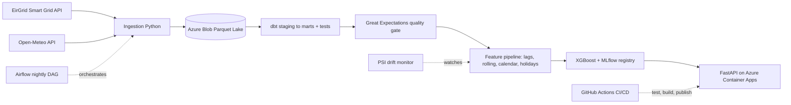

# ⚡ Irish Electricity Demand Forecasting — DE → DS → MLOps

An end-to-end platform that forecasts **Republic of Ireland national electricity demand** (MW) from live grid + weather data — covering **data engineering, data science, and MLOps** in one repo.

**Live API:** https://energy-demand-api.bluedesert-d99535e4.switzerlandnorth.azurecontainerapps.io
(try `GET /health` or `POST /predict`; `/docs` for Swagger)

---

## Architecture

## Tech stack to skills

| Layer | Tools |
|---|---|
| Ingestion | Python, requests to Azure Blob (Parquet) |
| Lake / IaC | Azure ADLS Gen2, Terraform |
| Transform | dbt (dbt-duckdb), SQL staging to marts |
| Data quality | Great Expectations, dbt tests |
| Orchestration | Apache Airflow (Docker), nightly DAG |
| ML | scikit-learn, XGBoost, time-series backtest |
| Experiment tracking | MLflow tracking + model registry |
| Serving | FastAPI, Docker, Azure Container Apps |
| CI/CD | GitHub Actions to GHCR |
| Monitoring | PSI data-drift detection + retrain trigger |

## Data (free, no API key)
- EirGrid Smart Grid Dashboard — 15-min system demand (ROI), ~2 years history
- Open-Meteo — hourly temperature, wind, humidity (Dublin)
- Irish bank holidays (holidays library)

## Results

Forecasting next-hour demand; 30-day time-based holdout, vs a seasonal-naive baseline.

| Model | MAE (MW) | RMSE (MW) | MAPE |
|---|---|---|---|
| Seasonal-naive (last week) | 91 | 132 | 2.24% |
| XGBoost | 39 | 51 | 0.96% |

XGBoost cuts error ~57% vs the baseline. Honest note: next-hour demand is highly autocorrelated, so sub-1% MAPE is expected at a 1-hour horizon; multi-hour forecasting is the harder extension (future work).

## MLOps features
- Reproducible infra via Terraform
- Automated pipeline (Airflow): ingest to dbt to quality to features to retrain, nightly
- CI/CD: every push runs tests, builds the image, publishes to GHCR
- Model registry: versioned models in MLflow; API serves the registered model
- Drift monitoring: PSI flags when inputs shift and a retrain is warranted

## Honest limitations
- EirGrid's API is undocumented; occasional empty months are handled with retries/skips.
- Weather uses Open-Meteo (Met Eireann's raw CSV host was unreliable) — a stable proxy.
- Single-site (Dublin) weather; a population-weighted multi-station blend would improve accuracy.
- Student Azure subscription (region-locked, no ACR cloud build) shaped some deployment choices.

## Author
Uthej Alagani — MSc Data Science, Maynooth University · Dublin, Ireland
